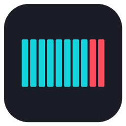

# lr2hp-for-osu


osu!lazer 매니아(1~7K)용 LR2 HP 게이지 [tosu](https://github.com/tosuapp/tosu) 오버레이와 기록 앱입니다.

## 사용법

### 설치

1. [Releases](https://github.com/asdf234a/lr2hp-for-osu/releases)에서 두 파일을 받습니다.
   - `lr2hp-for-osu-overlays-*.zip`: 오버레이 3개 (게이지, 대시보드, 공POOR 표시)
   - `lr2hp-for-osu-app-*.zip`: `lr2hp-for-osu.exe` ([.NET 10 데스크톱 런타임](https://dotnet.microsoft.com/download/dotnet/10.0) 필요)
2. 오버레이 압축을 풀어 세 폴더를 tosu의 `static` 폴더에 넣습니다. 예: `tosu/static/lr2hp-for-osu`. 세 폴더는 코드를 함께 쓰므로 나란히 있어야 합니다. 레포에서 직접 받을 때는 `overlays` 폴더 안의 세 폴더를 넣습니다.
3. 앱 압축을 풀면 `lr2hp-for-osu` 폴더(`lr2hp-for-osu.exe`, `settings.json`, `keybinds.json`)가 나옵니다. 이 폴더를 통째로 원하는 곳(예: `tosu/lr2hp-for-osu/`)에 두고 `lr2hp-for-osu.exe`를 실행합니다. 바탕화면처럼 다른 파일과 섞이는 곳에 exe만 꺼내 두지 마세요. 새 버전으로 올릴 때는 `lr2hp-for-osu.exe`만 바꿉니다. 새 zip의 json까지 덮어쓰면 설정이 기본값으로 돌아갑니다. 기록과 설정은 exe와 같은 폴더에만 저장되므로 폴더째 옮겨도 그대로 따라갑니다. 저장할 때마다 이전 기록을 `backup` 폴더에 남기고(`clears.json.bak`), 기록 파일이 깨지면 그 파일을 `backup` 폴더로 옮긴 뒤(`clears.json.corrupt-날짜`) 백업에서 복구합니다. 앱 로그는 `logs` 폴더(`lr2hp-for-osu.log`)에 남습니다.

### 플레이

- tosu와 앱을 켜고 osu!lazer 또는 osu!stable에서 매니아를 플레이합니다.
- 5K 이상은 앱이 켜져 있어야 키 입력(공POOR 판별)을 받을 수 있습니다. 1~4K는 tosu만으로도 동작합니다.
- 키 배치는 앱이 osu!lazer / stable의 매니아 키 설정에서 자동으로 가져옵니다.
- 결과 화면까지 간 플레이는 앱에 **맵(난이도) + 배속**별로 저장됩니다. FAILED도 저장됩니다.
- 무엇을 기록할지는 앱이 tosu를 보고 정하고, 게이지와 램프는 게이지 오버레이에게 받아 옵니다. 그래서 게이지 오버레이가 켜져 있어야 기록되고, 플레이 도중에 켜거나 새로고침한 판은 기록되지 않습니다.
- 플레이 바로 다음 결과 화면만 기록합니다. 리플레이, 포기하거나 osu!에서 실패한 판 뒤에 연 순위표 점수는 기록하지 않습니다. 오버레이가 여러 곳(OBS, 인게임 오버레이, 브라우저)에 떠 있어도 한 판은 한 번만 저장됩니다.
- 앱과 오버레이는 같은 버전끼리 써야 합니다. 예전 오버레이가 보내는 결과는 무시되고 앱 로그에 남습니다.

### OBS 브라우저 소스

| 오버레이 | URL | 크기 |
|---|---|---|
| 게이지 | `http://127.0.0.1:24050/lr2hp-for-osu/` | 720x64 (폭은 게이지 길이 + 120px) |
| 대시보드 | `http://127.0.0.1:24050/lr2hp-for-osu-dashboard/` | 230x260 |
| 공POOR 표시 | `http://127.0.0.1:24050/lr2hp-for-osu-emptypoor/` | 76x32 (Iridium 기준) |

설정은 tosu 대시보드(`http://127.0.0.1:24050`)에서 **lr2hp-for-osu**, **lr2hp-for-osu Dashboard**, **lr2hp-for-osu Empty POOR**를 찾아 바꿉니다.

### 앱 화면

- 지금 선택된 곡과 그 배속의 기록 카드를 보여줍니다. 카드에는 클리어 램프, 최고 EX 스코어와 레이트, 최저 BP(BAD + POOR + 공POOR), BMS 랭크와 가까운 랭크 경계까지의 점수(예: `AAA-0006`)가 나옵니다.
- 카드 아래 칩은 다른 배속의 램프입니다.
- 클리어 램프: FAILED / EASY / CLEAR / HARD / EX-HARD / FULL COMBO / PERFECT / MAX (색과 깜빡임은 beatoraja m_select 스킨 기준)
- 창은 아무 곳이나 끌어서 옮깁니다. 핀 버튼으로 항상 위 고정을 켜고 끕니다.
- **기록 삭제**: 기록 카드나 배속 칩을 우클릭해 **Delete all records of this map**을 누르면 그 맵의 기록이 모두 지워집니다.

## 설정

### 앱 (톱니바퀴 버튼)

| 설정 | 설명 |
|---|---|
| Theme | Dark / Light / System |
| Lamp blink | FAILED, EX-HARD, FULL COMBO, PERFECT, MAX 램프의 깜빡임. Slow(기본, 천천히 바뀜) / Fast(m_select 원래 속도) / Off |
| Song and artist names | 곡·아티스트 이름을 원어(Original) / 영어(English)로 표시 |
| Key bindings | osu!lazer / stable 키 설정 다시 읽기. 지금 맵에 쓰는 키 배치와 읽어온 위치를 보여줍니다 |
| Data | 기록과 설정이 있는 폴더 열기 |

### 게이지 오버레이 (lr2hp-for-osu)

**Gauge**

| 설정 | 기본값 | 설명 |
|---|---|---|
| Start gauge (GAS) | EX-HARD | GAS(게이지 오토 시프트)를 시작할 게이지. 실패하면 다음 게이지로 내려갑니다 |
| Bottom gauge (GAS) | EASY | GAS가 내려갈 수 있는 가장 낮은 게이지 |
| TOTAL formula | standard | standard: `7.605N/(0.01N+6.5)` / lr2: `160+(N+clamp(N−400,0,200))×0.16` / beatoraja: `max(260, standard)` / custom: 아래 값 |
| Custom TOTAL | 300 | TOTAL formula가 custom일 때 쓰는 값 |

**Empty POOR**

| 설정 | 기본값 | 설명 |
|---|---|---|
| Count empty POOR | 켬 | 노트에 맞지 않은 키 입력을 공POOR로 셉니다 |
| Empty POOR mode | lr2oraja | lr2oraja: 그 레인의 다음 노트 1초 전까지의 입력만(LR2 규칙) / near: 다음 노트가 500ms 안일 때만 / all: 모든 헛누름. 어느 모드든 첫 노트 전의 입력은 세지 않음 |
| Early-press MISS counts as BAD | 켬 | 너무 일찍 눌러 생긴 osu!의 MISS(OD8 기준 127~164ms 이르게)를 LR2처럼 BAD로 셉니다 |
| Key helper port | 24055 | 앱과 연결하는 포트 |
| Input offset (ms) | 0 | 보통 0. 곡 시간은 osu!의 판정 오차로 자동 보정됩니다 |
| Show press stats | 끔 | 확정된 입력, 이른 MISS, 공POOR 수와 시간 보정값을 표시 (디버그용) |
| Key layout source | sync | sync: 앱이 가져온 osu! 키 설정 사용 / manual: 아래 키 배치 사용 |
| 4K ~ 10K keys | | 왼쪽부터 공백으로 구분한 키 이름. 예: `S D F Space J K L` |

**Look**

| 설정 | 기본값 | 설명 |
|---|---|---|
| Skin | flat | flat: simple-play의 평면 게이지 / classic: simple-play 원본의 광택 있는 빨강·청록 게이지 |
| Segments | 50 | 게이지 칸 수. LR2는 50(칸당 2%), simple-play 스킨은 60 |
| Gauge length (px) | 0 | 숫자를 뺀 막대 길이. 0이면 스킨 기본(칸당 12px) |
| Scale | 1 | 전체 크기 |
| Show gauge name | 켬 | 게이지 이름 표시 |
| Show all four gauges | 끔 | 뒤에서 돌아가는 네 게이지 값을 작게 표시 |
| Show empty POOR status | 켬 | 공POOR를 셀 수 없을 때 안내 표시 |
| Hide outside play | 켬 | 플레이 중이 아닐 때 숨김 |

### 대시보드 (lr2hp-for-osu-dashboard)

| 설정 | 기본값 | 설명 |
|---|---|---|
| Rank | 켬 | 지금 스코어 레이트의 BMS 랭크 (AAA 8/9, AA 7/9 …) |
| EX score | 켬 | PGREAT × 2 + GREAT |
| Score rate | 켬 | 지금까지 판정된 노트 기준 EX 스코어 비율 |
| Judge count | ON+FAST/SLOW | PG / GR / GD / BD / PR / KP(공POOR) / CB(콤보 브레이크). ON+FAST/SLOW / ON / OFF |
| Max combo | 켬 | BMS 콤보 (BAD, POOR에서 끊김, 공POOR는 영향 없음) |
| Counter image | default | simple-play 카운터 이미지: default / default_old |
| Rank image | noto | simple-play 랭크 이미지: noto / default / default_s / default2 / block / neonew / KCOOL |
| Scale | 1 | 전체 크기 |
| Hide outside play | 켬 | 플레이 중이 아닐 때 숨김 |
| lr2hp-for-osu overlay folder | lr2hp-for-osu | 게이지 오버레이 폴더 이름. 키 배치와 공POOR 설정을 여기서 읽습니다 |

### 공POOR 표시 (lr2hp-for-osu-emptypoor)

| 설정 | 기본값 | 설명 |
|---|---|---|
| Judge image | default | `skins/judge`의 POOR 판정 이미지. default: simple-play 원작 default3의 MISS / default1, default2, default4: 원작의 POOR 이미지 |
| Trim empty space | 켬 | 이미지의 빈 공간을 잘라 글자에 맞춤 |
| Show time (ms) | 500 | 표시 시간 (beatoraja 기준 500ms) |
| Scale | 1 | 전체 크기 |
| lr2hp-for-osu overlay folder | lr2hp-for-osu | 게이지 오버레이 폴더 이름. 키 배치와 공POOR 설정을 여기서 읽습니다 |

## 커스텀 스킨

스킨 이미지는 beatoraja 스킨(simple-play 계열)과 같은 형식입니다. 새 스킨을 넣은 뒤에는 그 오버레이 폴더의 `settings.json`에서 해당 설정의 `options` 목록에 이름을 추가해야 tosu 설정에서 고를 수 있습니다. tosu를 다시 켜거나 대시보드에서 오버레이를 새로고침하면 반영됩니다.

### 게이지 (`lr2hp-for-osu/skins/<이름>/`)

| 파일 | 내용 |
|---|---|
| `gauge.png` | beatoraja 8노드 게이지 이미지 (simple-play의 `customize/gauge/<스킨>/gauge.png` 그대로) |
| `num.png` | 게이지 숫자 이미지 (같은 폴더의 `num.png`) |
| `skin.json` | `{"segment": [12, 35], "width": 12, "rows": {"groove": 0, "hard": 0, "easy": 1, "exhard": 1}}`. 없으면 이 기본값을 씁니다 |

`gauge.png`나 `num.png`가 없거나 읽을 수 없으면 flat 스킨으로 표시됩니다.

- `segment`: gauge.png에서 노드 한 칸의 크기 [가로, 세로]
- `width`: Gauge length가 0일 때 화면에서 한 칸의 폭(px)
- `rows`: 게이지별로 쓸 노드 줄 (0: 위 줄, 1: 아래 줄)

`skins/flat` 폴더를 복사해 이미지만 바꾸는 게 가장 쉽습니다. 그다음 `lr2hp-for-osu/settings.json`의 `skin` 설정 `options`에 폴더 이름을 넣습니다.

### 대시보드 (`lr2hp-for-osu-dashboard/skins/`)

- 카운터: `skins/counter/<이름>.png`. simple-play의 `customize/counter` 이미지와 같은 배치. `settings.json`의 `counter` 옵션에 이름 추가
- 랭크: `skins/rank/<이름>.png`. simple-play의 `customize/rank` 이미지와 같은 배치. `settings.json`의 `rank` 옵션에 이름 추가

### 공POOR 판정 (`lr2hp-for-osu-emptypoor/skins/judge/`)

beatoraja 판정 스킨 폴더(`F_PR.png`와 `judge.lua`가 있는 폴더)에서 가져옵니다. Python과 Pillow가 필요합니다.

```
python tools/import_judges.py "<beatoraja>/skin/<스킨>/customize/judge" "<tosu>/static/lr2hp-for-osu-emptypoor/skins/judge" --only <판정 폴더 이름>
```

- `--only`: 가져올 판정 폴더 하나. 빼면 모든 판정 폴더를 가져옵니다
- `--as <이름>`: 다른 이름으로 저장. 예: `--as default`로 기본 판정을 바꿉니다
- 이미 있는 판정은 그대로 두고 `judges.json`에 추가합니다

그다음 `lr2hp-for-osu-emptypoor/settings.json`의 `judge` 옵션에 이름을 추가합니다. `--as default`로 넣었다면 추가할 필요가 없습니다.

---

게이지·숫자·카운터·랭크·판정 이미지: beatoraja 스킨 *simple-play* (mnpy) 및 그 수정본
